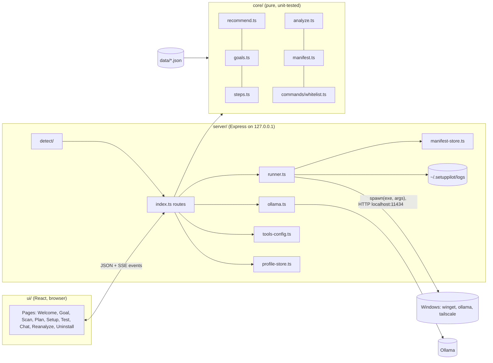

# Architecture

Three layers with one-way dependencies: `ui -> server -> core`. `core/` is pure logic and
the only place that decides what to run. `server/` is the only place with side effects.
Shapes between them are in `CONTRACTS.md`.

## Modules
| Module | Job | I/O? |
|---|---|---|
| core/recommend | profile + catalog -> Recommendation | no |
| core/goals | goal + profile + recommendation -> ordered Plan | no |
| core/steps | step definitions, skip rules, renders commands via whitelist | no |
| core/analyze | old profile + new profile -> UpgradeLadder | no |
| core/manifest | records -> UninstallPlan (reverse order) | no |
| core/commands/whitelist | the only CommandSpecs; validates params | no |
| server/detect | MachineProfile from Windows (nvidia-smi, WMI/CIM, winget, ollama) or mocks | yes |
| server/runner | runs RenderedCommands after approval check; streams RunEvents; logs | yes |
| server/ollama | list models, chat test (measures tokens/sec), narrator rephrase | yes |
| server/tools-config | writes coding-tool config (backup first, manifest record) | yes |
| server/profile-store, manifest-store | JSON files under `~/.setuppilot/` | yes |

## Main data flow
1. **Scan**: `GET /api/scan` -> detect -> MachineProfile (+ manual VRAM override from UI).
2. **Plan**: `POST /api/plan {goal}` -> recommend -> goals/steps -> Plan with rendered
   commands and `planHash`. UI shows every command before approval.
3. **Approve**: `POST /api/approve {planHash, mode, stepId?}` -> Approval id.
4. **Run**: `POST /api/run {approvalId}`; `GET /api/events` (SSE). Runner: check approval
   matches plan hash -> write manifest record (planned) -> spawn -> stream -> mark done/failed.
5. **Test**: `POST /api/test` -> one real prompt -> TestResult with measured tokens/sec.
6. **Later**: Re-analyze = scan again + `core/analyze` against saved profile.
   Uninstall = `core/manifest` builds plan from saved manifest -> approve -> runner.

## Demo mode
`DEMO_MODE=1`: detect reads `data/mock-profiles/<name>.json`; runner replays simulated
output with delays; ollama.ts returns a canned answer and a speed clearly marked
"demo, not measured". Same routes and UI.

## Narrator (optional)
A 1-3B model in Ollama rephrases `data/explanations.json` text and answers "why?".
Display-only, no tools; if absent or slow (>3 s), the static text is shown.
